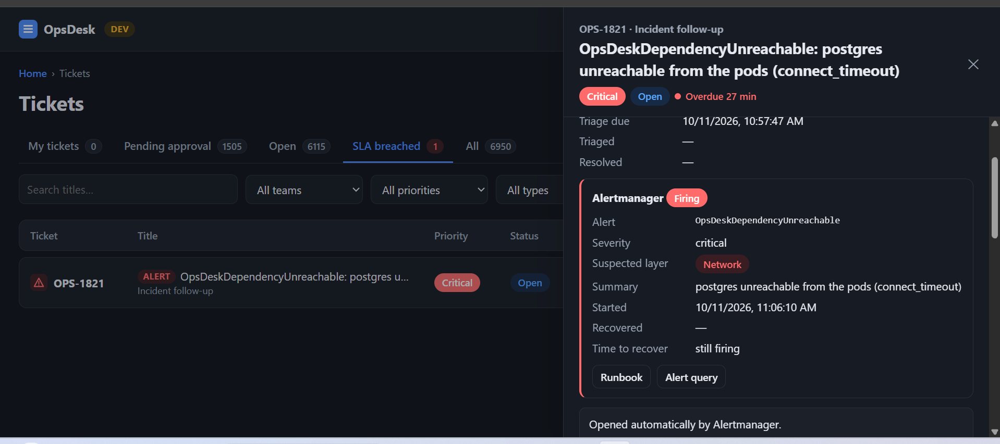
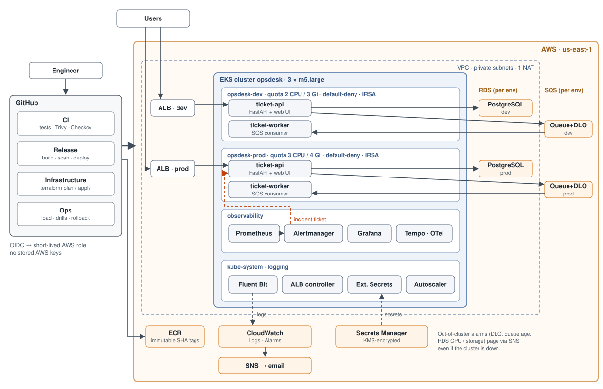
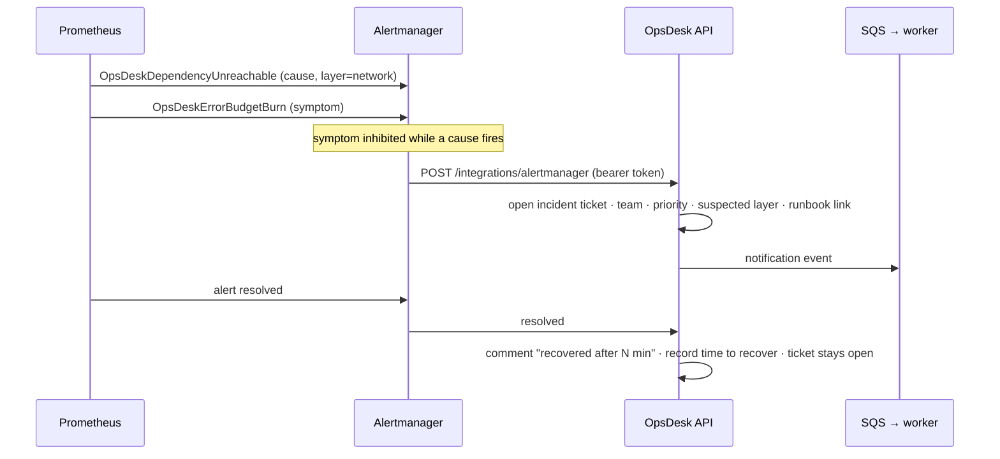
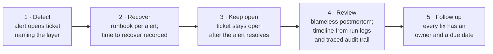
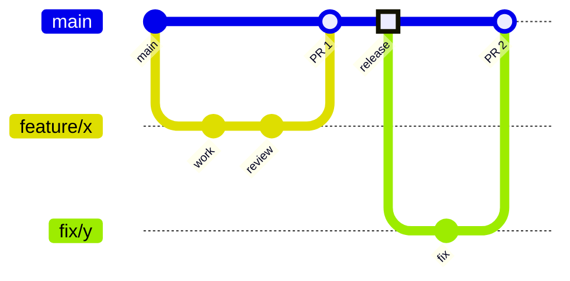
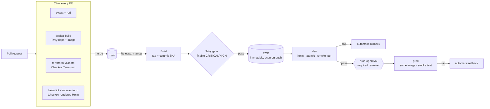

# OpsDesk — Telecom Observability & SRE Platform on Amazon EKS

[](https://github.com/ngems1/observability-sre/actions/workflows/ci.yml)


> **An incident ticket that names the failing layer — Kubernetes, application, queue, database or network —
> before anyone joins the call.** Built from code, deployed through GitHub Actions with no stored AWS keys, and
> proven by breaking it on purpose.

Week 4 project · Specialization: **Observability / SRE** · Author: **Sebastien Ngembou**



*Drill 6: the application could not reach PostgreSQL. Every user-visible symptom said "database" — failing queries,
unready pods, a 503 from the load balancer. RDS was healthy throughout. The platform opened this ticket naming
**network**, with no human in the loop. [Full evidence →](docs/evidence.md)*

---

## Contents

1. [The problem](#1-the-problem)
2. [The approach](#2-the-approach)
3. [Results](#3-results)
4. [Architecture](#4-architecture)
5. [Alerting and SLOs](#5-alerting-and-slos)
6. [Incident lifecycle and blameless postmortems](#6-incident-lifecycle-and-blameless-postmortems)
7. [Delivery: GitHub Flow and the pipeline](#7-delivery-github-flow-and-the-pipeline)
8. [Environments and isolation](#8-environments-and-isolation)
9. [Security](#9-security)
10. [Cost and optimization](#10-cost-and-optimization)
11. [Getting started](#11-getting-started)
12. [Operating the platform](#12-operating-the-platform)
13. [Repository layout](#13-repository-layout)
14. [Technology stack](#14-technology-stack)
15. [Known limitations and roadmap](#15-known-limitations-and-roadmap)
16. [Documentation](#16-documentation)

---

## 1. The problem

A telecom operator cannot quickly tell whether an outage comes from **Kubernetes, application code, queues,
databases or networking**. During an incident it does not lack dashboards — it has too many, and each team's says
its own layer is fine.

In a typical outage the fix takes minutes; working out *which layer broke* takes most of the incident. Against a
**99.5 % availability SLO** — an error budget of about **3 h 39 min a month** (0.5 % × 730 h) — the diagnosis
becomes the outage.

**Objective:** an observability platform on EKS with metrics, logs, traces, actionable alerts and incident
response, where the alert itself identifies the failing layer.

## 2. The approach

Every layer gets a signal that **only that layer can move**. One fault answers its own layer's question badly and
leaves the other four normal, so the pattern across the five is a fingerprint.

| Layer | The question only it answers | Signal | Cause alert |
| --- | --- | --- | --- |
| Kubernetes | Are the processes running? | ready vs desired replicas, restarts, worker presence | `OpsDeskWorkerDown`, `OpsDeskPodsUnavailable` |
| Application | Is our code erroring or slow? | 5xx ratio; request p95 vs database p95 | `OpsDeskDbPoolExhausted` (+ SLO symptoms) |
| Queue | Is work piling up? | SQS visible depth, DLQ depth, seconds since last poll | `OpsDeskQueueBacklog`, `OpsDeskDlqNotEmpty` |
| Database | Is SQL slow, or refused? | statement p99, database-side error kind | `OpsDeskDatabaseSlow`, `OpsDeskDatabaseErrors` |
| Network | Can we open a connection at all? | `connect_timeout` / `dns` / `refused` per minute | `OpsDeskDependencyUnreachable` |

**Every failed dependency call is classified** by `(dependency, kind)` in [`app/opsdesk/deps.py`](app/opsdesk/deps.py)
— `dns`, `connect_timeout`, `refused`, `connection_lost`, `auth`, `query_timeout`, `too_many_connections`,
`pool_timeout`, … — and exported as `opsdesk_dependency_errors_total{dependency,kind}`. The *kind* is what separates
a slow database from an unreachable one.

**Request time vs database time.** A request's latency is the application's own work plus time inside PostgreSQL.
The dashboard plots request p95 (`http_server_request_duration_seconds`) and database statement p95
(`opsdesk_db_query_duration_seconds`) on one panel, and the gap between them reads as:

| What the two lines do | Verdict |
| --- | --- |
| both rise together | **Database** — the app is waiting on storage |
| request rises, database flat | **Application** — the time went into our own code |
| database reports *no data*, connection errors climb | **Network** — no statement ever completed |

Triage starts on the Grafana dashboard **OpsDesk — Where is the fault?**: five verdict tiles, one row per layer,
one time axis.

## 3. Results

Faults injected into the live EKS cluster on **2026-10-11** under steady k6 load. Each is written up with the
claim it supports and the signals that did *not* move in [docs/evidence.md](docs/evidence.md).

| Drill | Fault | Platform's verdict | Time to ticket |
| --- | --- | --- | --- |
| 6 | Egress to PostgreSQL blocked by NetworkPolicy | **network** — database row reported *no data*, RDS healthy | ~2 min |
| 3a | Notification worker scaled to zero | **kubernetes**, then **queue** once the worker returned | ~2 min |
| 1 | API pod deleted | none — self-healed inside the alert window (by design) | n/a |
| 2a | 800 ms latency injected into the API | **application**, from the request/database divergence | panel only |

**One fault, one ticket.** During drill 3a three alert conditions were true at once and exactly one ticket existed
at a time, each naming its own layer:

```text
16:18  worker scaled to 0
16:20  OpsDeskWorkerDown fires          -> OPS-13674, layer kubernetes
16:20  OpsDeskQueueBacklog true         -> muted (WorkerDown inhibits it)
16:39  worker restored                  -> inhibition lifts
16:40  OpsDeskQueueBacklog fires        -> OPS-15858, layer queue
17:06  OpsDeskApiLatencyHigh true       -> muted (a cause is active)
```

**The drills found defects that reading the code did not** — written up in [docs/incidents.md](docs/incidents.md):
a NetworkPolicy does not bite while connection pools hold open connections; unready pods drop out of Prometheus's
scrape targets exactly when the fault is worst; a self-hosted incident recorder cannot record its own outage;
synthetic load buries real tickets; and a panel only ever seen healthy reported "63.4 years".

## 4. Architecture



*One EKS cluster, two isolated environments. Each environment has its own ALB, namespace, RDS instance, SQS queue +
DLQ, secret and IAM roles. Prometheus scrapes both namespaces; Alertmanager posts incident tickets to each
environment's own API (prod shown). Images come only from ECR; secrets arrive through External Secrets; logs leave
through Fluent Bit. CloudWatch alarms reach SNS from outside the cluster.*

**The workload** is OpsDesk, the operations team's internal ticketing and access-request portal — the system being
observed, and also where incidents are recorded:

- **ticket-api** (FastAPI) — REST API and web UI; publishes notification events to SQS with the W3C `traceparent`
  in the message attributes.
- **ticket-worker** — SQS consumer; delivers notifications (Slack or log-only). At-least-once delivery with the
  notification row as the idempotency key; three failed receives move a message to the DLQ.
- **PostgreSQL** on RDS, one instance per environment; schema managed by Alembic in an advisory-locked
  initContainer.

**Telemetry paths**

| Signal | Path | Retention |
| --- | --- | --- |
| Metrics | app `/metrics` → ServiceMonitor → Prometheus → Grafana; kube-state-metrics, CoreDNS, node exporter | Prometheus PVC (20 GiB) |
| Logs | JSON to stdout (`trace_id`, `span_id`, `ticket_id`, `route`, `status`, `duration_ms`) → Fluent Bit → CloudWatch Logs; Logs Insights queries in Terraform | 7 days |
| Traces | OpenTelemetry SDK → OTel Collector → Tempo; one trace from browser click → API → SQL → SQS → worker; exemplars link the latency panel to traces | Tempo PVC (10 GiB) |
| Alerts | PrometheusRule → Alertmanager → OpsDesk incident ticket; CloudWatch alarms (DLQ, queue age, RDS CPU, RDS storage) → SNS email | — |

The CloudWatch → SNS path runs **outside the cluster**, so a cluster-wide outage still reaches a human.

## 5. Alerting and SLOs

Alerts ship with the Helm chart ([`helm/opsdesk/templates/prometheusrule.yaml`](helm/opsdesk/templates/prometheusrule.yaml))
and carry four labels: `severity` (→ ticket priority), `team` (→ ticket team), `layer` (→ *Suspected layer*) and
`alert_type` (`cause` or `symptom`), plus a `runbook_url` into [docs/runbook.md](docs/runbook.md).

| Type | Alerts | Meaning |
| --- | --- | --- |
| **Symptom** | `OpsDeskErrorBudgetBurn`, `OpsDeskApiLatencyHigh` | users are affected; layer unknown |
| **Cause** | `WorkerDown`, `PodsUnavailable`, `QueueBacklog`, `DlqNotEmpty`, `DatabaseSlow`, `DatabaseErrors`, `DbPoolExhausted`, `DependencyUnreachable` | names exactly one layer |

**SLOs and thresholds** (from [`helm/opsdesk/values.yaml`](helm/opsdesk/values.yaml)):

| Objective | Target | Alert |
| --- | --- | --- |
| Availability (non-5xx ratio) | 99.5 % | multi-window burn rate: **14.4×** over 1 h + 5 min (fast), **6×** over 6 h + 30 min (slow) |
| API latency p95 | 500 ms | for 10 min |
| Database statement p99 | 250 ms | for 5 min |
| Queue backlog | 20 visible messages | — |

**Inhibition** ([`terraform/platform/observability.tf`](terraform/platform/observability.tf)): while any cause
fires in a namespace, Alertmanager mutes that namespace's symptoms; a cause also mutes its own consequence
(`WorkerDown` mutes `QueueBacklog`). One fault produces one ticket with one owner — not six tickets describing its
echoes.



The webhook is **idempotent per alert fingerprint** (advisory lock + partial unique index): repeat deliveries are
no-ops, a re-fire on an open ticket becomes a comment, and resolution records
`opsdesk_incident_time_to_recover_seconds`.

## 6. Incident lifecycle and blameless postmortems



Recovery ends the outage; the postmortem stops it recurring. Postmortems here are **blameless**: they ask why the
system allowed the failure and why it took a drill to find it, not who caused it. Blame makes people hide mistakes,
and the facts needed to fix the system are lost.

- On-call steps per alert, and the postmortem template: [docs/runbook.md](docs/runbook.md)
- The drill 6 postmortem, with follow-ups, owners and due dates: [docs/incidents.md](docs/incidents.md)

## 7. Delivery: GitHub Flow and the pipeline

### Branching strategy — GitHub Flow

`main` is always deployable. All work happens on short-lived branches merged through pull requests; a Release
runs from `main` after the merge (highlighted).



| Rule | Why |
| --- | --- |
| Branch from `main`, named `feature/…`, `fix/…`, `infra/…`, `docs/…` | short-lived, one purpose per branch |
| Open a pull request early | CI and (for `terraform/**`) a Terraform plan run on every PR |
| Merge only when CI is green and the PR is reviewed; squash merge | `main` history is one commit per change, every commit deployable |
| Deploy from `main` only | the OIDC trust policy allows `main`, pull requests and the `dev`/`prod` environments — nothing else can assume the AWS role |
| One image per commit, promoted unchanged | the image tested in dev is byte-for-byte the image in prod |
| Fix forward or roll back; never hot-patch a cluster | every change is in Git and goes through the same gates |

Recommended branch protection on `main`: require a pull request, require the CI jobs (`app`, `image`, `iac`,
`helm`) to pass, require branches to be up to date, block force pushes and deletion.

### Pipeline



| Workflow | Trigger | What it does |
| --- | --- | --- |
| **CI** | pull request; called by Release | four parallel jobs — app (ruff, pytest against real PostgreSQL with mocked SQS), image (build, Trivy deps + image, SARIF to code scanning), iac (fmt, validate, Checkov), helm (lint, render dev/prod, kubeconform, Checkov) |
| **Infrastructure** | PR / push on `terraform/**`: plan · manual: apply | Terraform `infra` then `platform`; apply runs in the `prod` environment and needs approval |
| **Release** | manual, from `main` | CI → build (skipped if the SHA is already in ECR) → Trivy gate → ECR → dev → approval → prod, Helm `--atomic`, smoke test and rollback per environment |
| **Ops** | manual, per environment | `status`, `load-start/stop`, drills, `errors-on/off`, `rollback`; logs before/after state as evidence |
| **Bootstrap** | manual, once | Terraform state bucket (+ ACM certificate when `DOMAIN_NAME` is set) |
| **Destroy** | manual, type `destroy` | apps → platform → infra, in the order that lets ALBs and the VPC delete cleanly |
| **Terraform fmt** | manual | formats Terraform and commits the result |

Release is deliberately manual: CI gates every pull request, but deploying is a decision, not a side effect of
merging. **Rollback:** Helm `--atomic` reverts a failed upgrade automatically; Ops → `rollback` returns an
environment to its previous Helm revision on demand.

## 8. Environments and isolation

`dev` and `prod` share one EKS cluster and are isolated like separate tenants. Sharing the cluster is the largest
cost saving; the controls below are what make it defensible.

| Control | dev (`opsdesk-dev`) | prod (`opsdesk-prod`) |
| --- | --- | --- |
| Namespace guardrails | Pod Security `restricted`, ResourceQuota 2 CPU / 3 Gi, LimitRange | same, quota 3 CPU / 4 Gi |
| Network | default-deny NetworkPolicy; ingress only from own namespace, Prometheus, ALB; egress allowlist | same |
| Data | own RDS instance, SQS queue + DLQ, secret, log group | own copies |
| AWS access | IRSA roles trusted only by its own namespace's service accounts | same |
| API capacity | 1 replica, HPA 1–3 | 2 replicas, HPA 2–6, PodDisruptionBudget |
| Entry point | own ALB (+ Grafana) | own ALB (+ Grafana) |
| Release | deployed first, smoke-tested | same image, after a reviewer approves |

## 9. Security

| Area | Implementation |
| --- | --- |
| **No long-lived credentials** | GitHub Actions assumes an AWS role through OIDC; pods use IRSA. No AWS access key exists anywhere in the system |
| **Least privilege** | per-environment IRSA roles; Fluent Bit writes only the app log groups; external-dns limited to one hosted zone; dev cannot read prod secrets |
| **Secrets** | AWS Secrets Manager → External Secrets Operator → Kubernetes Secret; nothing sensitive in the chart or the repo |
| **Encryption** | customer-managed KMS key for RDS, SQS, Secrets Manager, CloudWatch Logs and SNS; TLS at the ALB with HTTP redirected |
| **Workload hardening** | Pod Security `restricted`, non-root, read-only root filesystem, dropped capabilities, default-deny NetworkPolicy |
| **Supply chain** | Trivy on dependencies and image on every PR and before every push to ECR (fixable CRITICAL/HIGH fail the build); ECR immutable tags and scan on push |
| **IaC and manifests** | Checkov on Terraform (194 passed / 0 failed) and on rendered Helm for both environments (366 / 0); 42 exceptions, each justified inline next to the resource |
| **Account services** | GuardDuty, Security Hub, Inspector and CloudTrail in [`terraform/modules/security`](terraform/modules/security), enabled per repository variable (`ENABLE_GUARDDUTY`, …); off by default to control cost in a daily-rebuilt lab account |

Findings, owners and remediation: [docs/security/findings.md](docs/security/findings.md).

## 10. Cost and optimization

Baseline: about **$13.60 a day** for both environments (us-east-1 on-demand list prices, October 2026); EC2 nodes
are about half. Prod in the shared cluster adds about **$1.30 a day**, versus about $10 a day for a second cluster.

| Action | Effect | Monthly |
| --- | --- | --- |
| Baseline, left on 24/7 | — | ≈ $410 |
| 1. Run only while working; **Destroy** nightly (rebuild from code in ~40 min) | −75 % | ≈ $100 |
| 2. Spot capacity for nodes, three instance types (`NODE_CAPACITY_TYPE=SPOT`) | −57 % on EC2 | ≈ $70 |
| 3. Right-size 3 → 2 nodes from measured CPU (`NODE_DESIRED_SIZE=2`) | −33 % of compute | ≈ $65 |

Already in the code: cost-allocation tags (`Project`, `Env`, `Owner`) on every resource, an AWS Budget with email
alerts, 7-day log retention, ECR lifecycle rules, a single NAT gateway, no interface endpoints below ~80 GB/day,
single-AZ `db.t3.micro` per environment. Details and sources: [docs/cost.md](docs/cost.md).

## 11. Getting started

### Prerequisites

- An AWS account (us-east-1) and a GitHub repository with Actions enabled
- Nothing installed locally: Terraform, Helm and kubectl run inside the workflows

### One-time setup (summary — full steps in [docs/aws.md](docs/aws.md#one-time-setup))

1. **Trust GitHub in AWS** — create the IAM OIDC provider `token.actions.githubusercontent.com` and the role
   `opsdesk-github-deploy`, trusted only for this repository's `main`, pull requests and the `dev`/`prod`
   environments (also available as Terraform in `terraform/modules/github_oidc`).
2. **GitHub environments** — `dev` (no protection) and `prod` (required reviewer).
3. **Repository variables**

   | Variable | Required | Purpose |
   | --- | --- | --- |
   | `AWS_ROLE_ARN` | yes | role the workflows assume |
   | `OWNER` | yes | `Owner` cost-allocation tag |
   | `ALERT_EMAIL` | yes | SNS: budget and CloudWatch alarm emails |
   | `ALLOWED_CIDRS` | yes | who may reach the ALBs, e.g. `["203.0.113.10/32"]` |
   | `DOMAIN_NAME` | no | HTTPS on `dev.<domain>` / `opsdesk.<domain>` (Route 53 zone created by hand) |
   | `CONSOLE_ADMIN_ARNS` | no | EKS console access for your IAM user |
   | `NODE_CAPACITY_TYPE`, `NODE_INSTANCE_TYPES`, `NODE_DESIRED_SIZE` | no | cost optimizations |
   | `ENABLE_GUARDDUTY`, `ENABLE_SECURITYHUB`, `ENABLE_INSPECTOR`, `ENABLE_CLOUDTRAIL` | no | account security services |

   Optional secret: `SLACK_WEBHOOK_URL` (otherwise notifications are log-only).
4. **Bootstrap** workflow — creates the Terraform state bucket (versioned, encrypted, TLS-only; S3 native locking).

### Bring it up

| Step | GitHub → Actions | Time |
| --- | --- | --- |
| 1 | **Infrastructure** → `apply` → approve | ~30 min (EKS, RDS, platform add-ons) |
| 2 | **Release** → run on `main` → dev deploys → approve prod | ~13 min |
| 3 | **Ops** → `dev` → `load-start` | 1 min (k6, 5 req/s in-cluster) |

The Release summary prints each environment's web UI and Grafana URLs. Logins are in Secrets Manager
(`opsdesk-<env>/app`, `opsdesk/grafana`).

**Tear down:** Actions → **Destroy** → type `destroy`. The state bucket and certificate survive, so the next
bring-up starts from step 1.

### Run it locally (Docker Desktop Kubernetes)

```powershell
./scripts/local-up.ps1 -Observability -Load   # build, deps, Prometheus/Grafana/Tempo, chart, k6, smoke test
./scripts/local-down.ps1 -All
```

Web UI <http://localhost:8080>, Grafana <http://localhost:3000>. PostgreSQL and ElasticMQ (SQS-compatible) run in
`opsdesk-deps`. Docker Desktop does not enforce NetworkPolicies, so the network drill runs on EKS only.

### Develop and test

```powershell
docker run -d --name opsdesk-pg -e POSTGRES_USER=opsdesk -e POSTGRES_PASSWORD=opsdesk -e POSTGRES_DB=opsdesk_test -p 5432:5432 postgres:16-alpine
cd app; python -m venv .venv; .\.venv\Scripts\Activate.ps1
pip install -r requirements-dev.txt
pytest -q                          # 50+ tests: real PostgreSQL via Alembic, SQS mocked with moto
ruff check . ; ruff format --check .
```

## 12. Operating the platform

**Failure drills** run from Actions → **Ops**, environment `dev`. Keep Grafana → *OpsDesk — Where is the fault?*
open; the red tile should match the drill's layer, and the *Environment* dropdown shows prod staying green.

| Drill | Inject | Recover | Expected verdict | Status |
| --- | --- | --- | --- | --- |
| 1 Pod failure | `drill1-pod-kill` | automatic | none — self-heals | run |
| 2a Latency (injected) | `drill2-latency-on` | `drill2-latency-off` | application (panel) | run |
| 2b Missing index | `drill2-seed-1m-tickets` → `drill2-explain` | `drill2-fix-index` | database | not yet run |
| 3a Stuck queue | `drill3-stuck-queue-on` | `drill3-stuck-queue-off` | kubernetes → queue | run |
| 3b Poison message | `drill3-poison-message` | redrive / purge DLQ | queue | not yet run |
| 4 Connection limit | `drill4-pool-exhaustion-on` | `drill4-pool-exhaustion-off` | database | not yet run |
| 5 Error budget | `errors-on` | `errors-off` | SLO burn (symptom) | not yet run |
| 6 Network | `drill6-network-block-db-on` | `drill6-network-block-db-off` | network | run |
| 7 Noisy neighbour | `drill7-noisy-neighbour-on` | `drill7-noisy-neighbour-off` | none — quota refuses pods | not yet run |

**On call:** start at [docs/runbook.md — Find the layer first](docs/runbook.md); every alert links to its own
section. **Logs:** CloudWatch Logs Insights queries are provisioned per environment; every line carries `trace_id`.

## 13. Repository layout

```text
app/                      FastAPI service, SQS worker, web UI, Alembic migrations, tests, Dockerfile
helm/opsdesk/             chart: Deployments, HPA, PDB, probes, NetworkPolicies, ExternalSecret,
                          ServiceMonitor, PrometheusRule; values-{local,eks,dev,prod}.yaml
terraform/
  bootstrap/              state bucket, optional ACM certificate, optional GitHub OIDC role
  infra/                  VPC, EKS, ECR, KMS, SNS/budget, security services; module "environment" per env
  platform/               namespaces + quotas, ALB controller, External Secrets, external-dns, autoscaler,
                          metrics-server, Fluent Bit, kube-prometheus-stack, Tempo, OTel Collector, dashboards
  modules/                one module per component: network, eks, ecr, kms, rds, sqs, secrets, irsa,
                          environment, observability, security, github_oidc
deploy/                   Grafana dashboards (JSON + ConfigMap), kube-prometheus-stack and Tempo values,
                          local Postgres/ElasticMQ manifests
.github/workflows/        ci, infra, release, ops, bootstrap, destroy, tf-fmt
scripts/                  aws/ (up, down, deploy-app, smoke, load, info) · local-up/down.ps1 · smoke.ps1
load/                     k6 constant-arrival-rate script and in-cluster Deployment
chaos/                    failure-drill helpers
docs/                     evidence, incidents and postmortem, runbook, AWS guide, cost, security findings
```

## 14. Technology stack

| Concern | Choice |
| --- | --- |
| Compute | Amazon EKS (managed node group, m5.large), Cluster Autoscaler, HPA |
| Data | Amazon RDS for PostgreSQL 16, Amazon SQS + DLQ |
| Ingress | AWS Load Balancer Controller (ALB), external-dns, ACM |
| Delivery | GitHub Actions, GitHub OIDC, Amazon ECR, Helm 3 |
| Infrastructure as code | Terraform ≥ 1.10, AWS provider 5.x, S3 backend with native locking |
| Metrics and alerting | kube-prometheus-stack (Prometheus, Alertmanager, Grafana), kube-state-metrics |
| Logs | Fluent Bit → Amazon CloudWatch Logs, Logs Insights |
| Traces | OpenTelemetry SDK + Collector, Grafana Tempo |
| Security | IRSA, KMS, Secrets Manager + External Secrets, Trivy, Checkov, kubeconform |
| Application | Python 3.12, FastAPI, SQLAlchemy, Alembic |
| Load | k6 |

## 15. Known limitations and roadmap

**Limitations — stated up front:**

- **Four of nine drills have been run.** Dev/prod isolation is therefore a design property, not yet a demonstrated
  one (drill 7 proves it).
- **A latency-only fault lights no verdict tile** — the Application tile measures error ratio; it is found on the
  request/database panel.
- **Traces are wired but thin** — deployed and linked from exemplars, not exercised in the drills.
- **Synthetic load is uniform**; real traffic has peaks, bursts and retries.

**Roadmap (postmortem follow-ups first):**

- [x] Drill 6 restarts workloads so the NetworkPolicy affects live traffic
- [ ] Alert on missing scrape targets, so metrics cannot go silent during an outage
- [ ] Route critical Alertmanager alerts to SNS as well as OpsDesk — a second path when OpsDesk itself is down
- [ ] Run drills 7 and 2b; add a p95 term to the Application verdict
- [ ] Shorten the SLO window; fix the worker-poll panel
- [ ] Spot + two nodes by default; Graviton (arm64) images

## 16. Documentation

| Document | Contents |
| --- | --- |
| [docs/evidence.md](docs/evidence.md) | each drill with the claim it supports and the signals that did and did not move |
| [docs/incidents.md](docs/incidents.md) | drill log, alert ordering, findings, **blameless postmortem for drill 6** |
| [docs/drill-evidence.md](docs/drill-evidence.md) | which panel to read for each drill and what each metric means |
| [docs/runbook.md](docs/runbook.md) | find the layer in two minutes; one section per alert; postmortem template |
| [docs/aws.md](docs/aws.md) | AWS and GitHub setup, workflows, HTTPS on a custom domain, troubleshooting |
| [docs/cost.md](docs/cost.md) | cost per day, three optimizations with numbers, sources |
| [docs/security/findings.md](docs/security/findings.md) | scan results, accepted exceptions, owners, remediation |
| [OpsDesk — Week 4 Presentation.pdf](OpsDesk%20%E2%80%94%20Week%204%20Presentation.pdf) | final presentation |

---

**Definition of done:** deployed from code, secured, observed, intentionally tested under failure, optimized — and
explained from both the engineering and the business side.
