# Failure drill evidence

Four faults injected into the **dev** environment on 2026-10-11, under steady synthetic load (k6, ~9 req/s).
Every timestamp below is UTC and comes from either the workflow log or the incident ticket, not from a wall clock.
The operational log and the lessons learned are in [incidents.md](incidents.md).

## How to read this

Each drill makes a claim about **which layer failed**. A claim is only evidence if it could have been wrong, so
every section below shows two things:

1. **The positive signal** — the metric that moved, against its own flat baseline to the left of the fault.
2. **The elimination** — the layers that did *not* move, which is what makes the localisation a conclusion rather
   than an assertion.

The second is the part that matters. Any dashboard can turn something red; the question is whether it turns the
*right* thing red while leaving the rest alone.

---

## Baseline

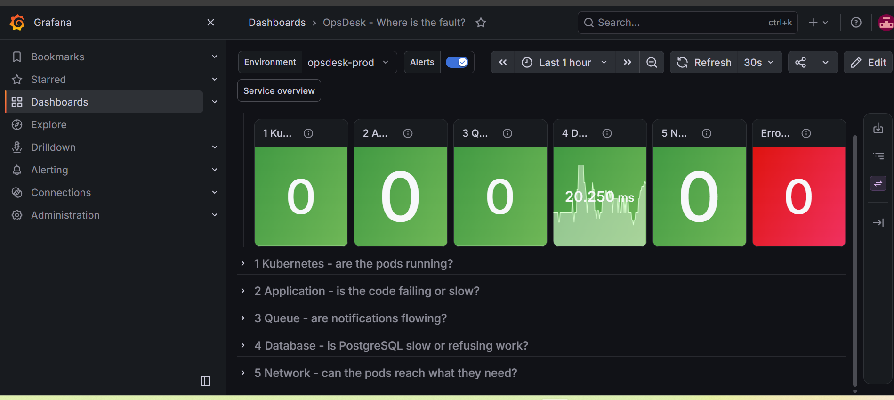

Steady state under load: Kubernetes 0, Application 0% errors, Queue 0, Database 20.25 ms p99 against a 250 ms
threshold, Network 0 failed connections. This is the reference every drill is measured against — "850 ms" means
nothing without "normally 100 ms" beside it.

*(Captured on `opsdesk-prod`; the drills ran on `opsdesk-dev`, which showed the same healthy pattern. The red
error-budget tile is a known measurement artifact — see Limits at the end.)*

---

## Drill 6 — PostgreSQL unreachable

**Fault:** port 5432 removed from the pods' egress NetworkPolicy, then both workloads restarted so they must open
new connections. **RDS itself was never touched.**

**Claim:** the platform reports *network*, not *database*, even though every user-visible symptom says database.

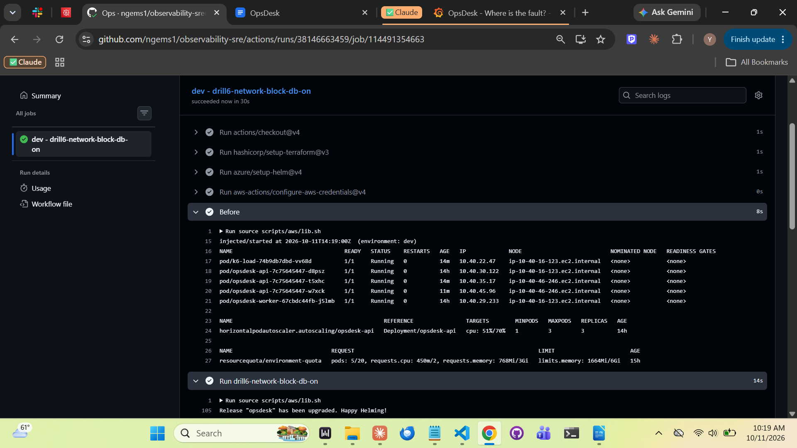

Injection timestamp and the pre-fault state in one frame: 3 API pods, 1 worker, all `1/1 Running`, zero restarts.
The cluster was healthy when the fault landed.

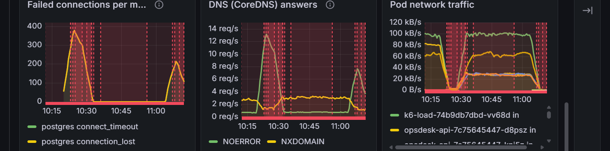

**The positive signal.** `postgres connect_timeout` and `postgres connection_lost` rise from a flat zero to
~380/min, fall back to zero between the two runs, and rise again. Both are network-class failure kinds: the
connection never completed.

**The elimination, and the whole point of the drill:** *Statement time p99* on the Database row reports **no data**
over the same window. A slow database has a high statement time. An unreachable one has none at all, because no
statement ever completes. That distinction is what separates "the database is struggling" from "we cannot reach
the database", and they call for opposite responses.


Total user-facing outage. `/readyz` pings the database, so every API pod failed readiness and the target group was
left with no healthy members. Worth showing because it is exactly the moment an on-call engineer would reach for
the database runbook.


**The conclusion, written down by the system.** Opened automatically by Alertmanager at 15:06:10Z from
`OpsDeskDependencyUnreachable`, critical, **Suspected layer: Network**, auto-assigned to Platform with a runbook
link. No human judgement was involved between the fault and this ticket.

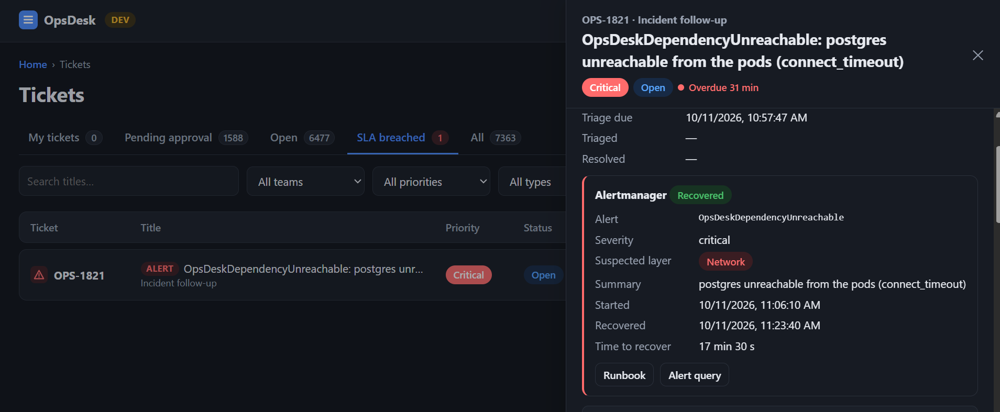

Recovery detected at 15:23:40Z and the elapsed time computed and stored on the ticket — 17 min 30 s — without
anyone typing a number. **That figure reflects when the injected fault was reverted, not a response time.** The
number that measures the platform is the ~2 minutes from fault onset to a correctly-labelled ticket, which is set
by the alert's `for: 2m` window and does not depend on anyone being awake.

---

## Drill 3a — notification worker stopped

**Fault:** `ticket-worker` scaled to zero. The API stays up, so unlike drill 6 the incident recorder survives and
the full alert-to-ticket chain can be observed.

**Claim:** the platform names *kubernetes* for the stopped consumer and *queue* for the backlog it causes, in that
order, and never opens both tickets at once.

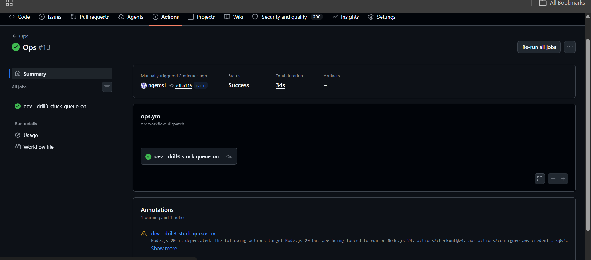

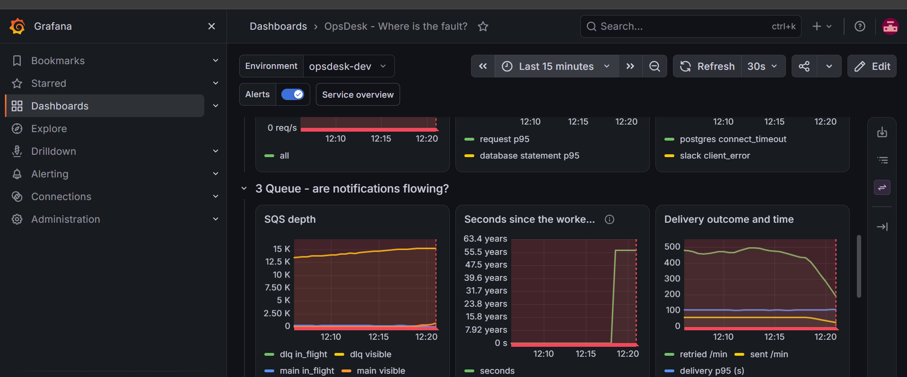

**Read this one carefully, because it is partly contaminated.** `main visible` was already near 12.5 K *before*
injection, and *Delivery outcome and time* shows `retried` at ~450/min against `sent` at zero. The cause is
`slack client_error` — the notification webhook rejecting every delivery — not this drill. The drill added to an
existing backlog rather than creating one, and the write-up says so.

*Seconds since the worker last polled* reads "63.4 years". That is a defect in the panel, not a measurement; see
Limits.

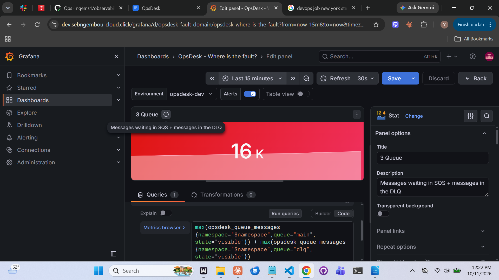

The Queue tile red at 16 K, with its query visible: main visible + DLQ visible, threshold 20.

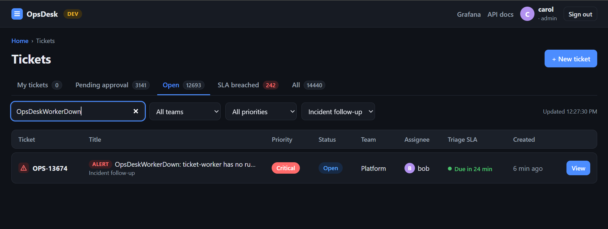

`OpsDeskWorkerDown`, critical, created roughly three minutes after injection, **layer kubernetes**, assigned to a
team. Note the rule behind it is `absent(up{job=...})`, not a replica count — a deployment scaled to zero has
nothing "unavailable", so a replica-based alert would have stayed silent. That choice is why this ticket exists.

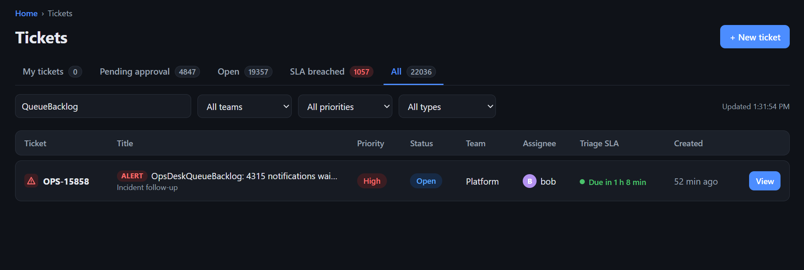

`OpsDeskQueueBacklog: 4315 notifications waiting`, **layer queue**, created at 16:40 — the exact minute
`OpsDeskWorkerDown` resolved and stopped suppressing it. The alert carries the backlog size into the title, so
whoever picks it up knows the scale before opening anything.

### The ordering is the proof

```
16:18  worker scaled to 0
16:20  OpsDeskWorkerDown fires            -> OPS-13674, layer kubernetes
16:20  OpsDeskQueueBacklog suppressed        (WorkerDown inhibits it)
16:39  worker restored, WorkerDown resolves
16:40  OpsDeskQueueBacklog now free       -> OPS-15858, layer queue
17:06  OpsDeskApiLatencyHigh suppressed      (QueueBacklog is a cause; symptoms are muted)
```

Three alert conditions were true across this window and **exactly one ticket existed at a time**, each naming its
own layer. That is not an accident of timing — it is the inhibition configuration in
`terraform/platform/observability.tf`: a cause mutes every symptom in its namespace, and `OpsDeskWorkerDown`
specifically mutes `OpsDeskQueueBacklog`, because a backlog is what a stopped worker *does*, not a separate problem.

This is the answer to "doesn't this page everyone at once?" — one fault, one ticket, one owner.

---

## Drill 1 — API pod deleted

**Claim:** the platform absorbs a pod loss without paging anyone, and the evidence distinguishes *replaced* from
*crash-looping*.

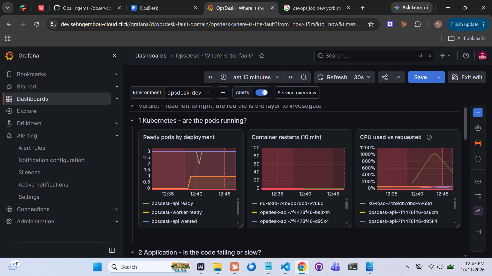

`opsdesk-api ready` drops from 3 to 2 at 16:41 while `wanted` holds at 3, and rejoins within a minute. **The gap
between those two lines is the entire fault.**

*Container restarts* stays flat at zero across every pod. Without that second panel, "the pod came back" could
equally mean a container restarting in place, which is a different and much worse problem.

**No alert fired, and that is the correct outcome.** `OpsDeskPodsUnavailable` requires five minutes of
unavailability; recovery took under one. The platform self-healed well inside its own alerting threshold, which is
what a pod-level fault *should* do. An alert here would be noise.

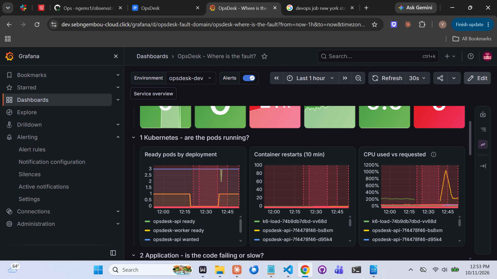

Both drills in one frame: the worker flat at zero from 16:18 to 16:39, the API dip at 16:41, restarts at zero
throughout.

---

## Drill 2a — 800 ms latency injected

**Claim:** the platform can tell *slow* from *broken*, and can place the slowness in the application rather than
the database.

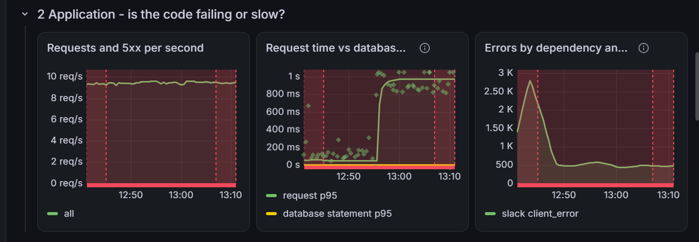

The clearest single image in the project.

- **`request p95`** steps from ~100 ms to ~1 s at 16:56 and holds.
- **`database statement p95` does not move at all** — flat on the floor for the entire window.
- **`all` requests steady at ~9 req/s with no 5xx series present.**

Request time is app time plus database time. Measure both, subtract, and the remainder is time the application
spent on its own work. Here the remainder is ~900 ms, so the fault is in the code path, not in storage and not in
the network. **Nothing failed** — zero errors throughout. Slow and broken are different conditions with different
responses, and separating them is the difference between a dashboard and a diagnosis.

The diamond markers on the request line are exemplars: each links to a trace, which is how you would go from "the
application is slow" to "this span is slow".

**This drill also exposed a real gap.** The *Application* verdict tile measures error ratio, so it stayed green
throughout — a latency-only fault lights no tile. The localisation came from the panel, and the symptom alert
(`OpsDeskApiLatencyHigh`) was correctly suppressed because a cause alert was active in the same namespace.
Adding a p95 term to that tile is on the next-steps list.

---

## Limits of this evidence

Stated plainly, because a reviewer will find them anyway.

**Four of seven drills were run.** Pod failure, elevated latency and stuck queue — the three named in the
assignment — plus the network drill. Database indexing, poison messages, connection-pool exhaustion, error
injection and namespace isolation were not exercised. In particular, **the dev/prod isolation is designed but not
tested**, so it is described here as a design property rather than a demonstrated one.

**The queue backlog is contaminated.** Most of the 16 K was caused by a rejecting Slack webhook before drill 3a
started, not by the drill.

**One panel is wrong.** *Seconds since the worker last polled* computes `time() - max(last_poll_timestamp)`; with
the worker absent the inner term evaluates to zero and the panel reports seconds since 1970 — "63.4 years". It
should report no data. Found by running the drill, which is the point of running drills.

**The error-budget tile is a measurement artifact.** It averages the error ratio over 30 days in an environment
rebuilt daily, so a brief burst during startup consumes the entire budget and the tile sits red. An SLO window has
to be shorter than the lifetime of the thing it measures.

**Recovery time is not response time.** The 17 min 30 s on OPS-1821 is how long the fault was left running.

**Synthetic load is uniform.** k6 drives a steady arrival rate; real telecom traffic has peaks, bursts, retries and
an uneven endpoint mix. These drills show the platform observing a steady system under failure, not a realistic
load shape.
